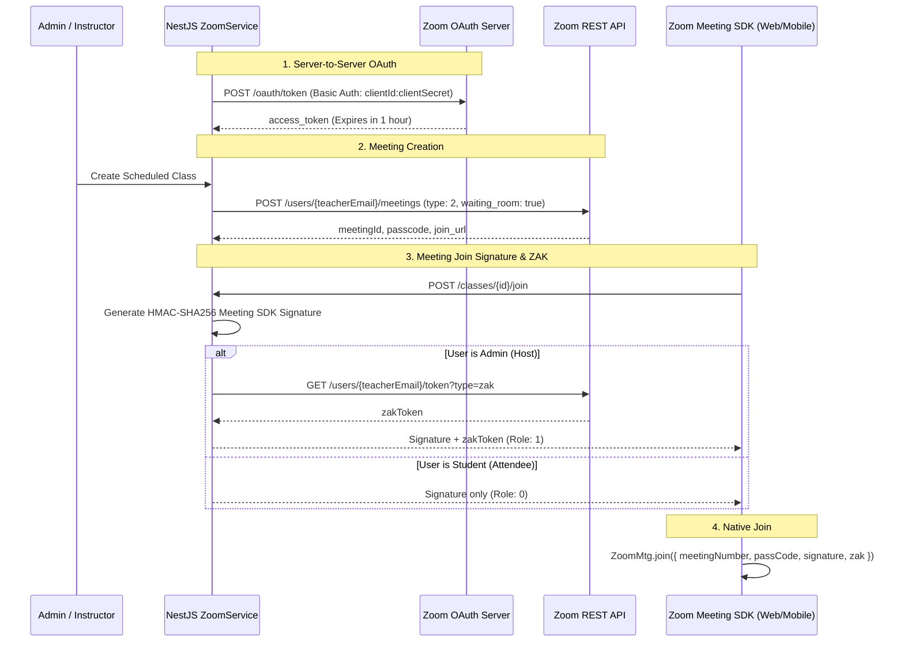

# Zoom Integration & Live Classroom Architecture

This document describes how Zoom is integrated into the Premier LMS ecosystem across the NestJS backend, Next.js web application, and Flutter mobile client.

---

## 🏗️ Architecture Overview

The system uses a hybrid approach combining **Zoom Server-to-Server OAuth** (for meeting automation on the backend) and **Zoom Meeting SDK** (for embedding the video meeting client directly inside the web and mobile UI):

---

## 🔑 Key Components

### 1. `ZoomService` (`src/modules/class/zoom.service.ts`)
* **Token Caching:** Automatically manages and refreshes Server-to-Server OAuth bearer tokens with in-memory expiration tracking.
* **Meeting Provisioning:** Creates Zoom meetings with settings:
  * `host_video: true`, `participant_video: true`
  * `audio: 'both'` (computer audio + phone)
  * `waiting_room: true` (host controls entry)
  * `auto_recording: 'cloud'` (automatically recorded to Zoom Cloud)
* **ZAK Token Issuance:** Acquires a Zoom Access Key (`zak`) for the teacher account so that when the admin opens the class on the web frontend, they immediately become the **Meeting Host** without logging into a Zoom app.
* **Meeting SDK Signature:** Generates the time-limited `HMAC-SHA256` token required by `@zoom/meetingsdk`.

### 2. Cloud Recording Webhooks
* When a class concludes and Zoom processes the cloud recording, Zoom fires a `recording.completed` webhook to the backend.
* The backend verifies the `zoom_webhook_secret` header.
* The webhook payload extracts the MP4 video download URL and creates a `RecordedLecture` entry linked to the corresponding `Course`.

### 3. Mobile Web Bridge (`EmbeddedZoomScreen`)
* In the Flutter mobile app, `EmbeddedZoomScreen` loads the frontend URL:
  `https://www.premiertaxschool.com/dashboard/classes/{id}?fromApp=true&token={jwt}`
* The web app initializes `@zoom/meetingsdk` within the WebView.
* Injected JavaScript bridges meeting status back to Flutter:
  * Audio mute / unmute state
  * Camera on / off state
  * Hand raise state
  * Real-time classroom chat messages (extracted via DOM mutation listeners and forwarded to `window.FlutterZoomBridge.postMessage`).
